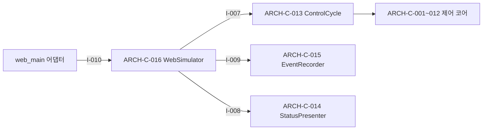
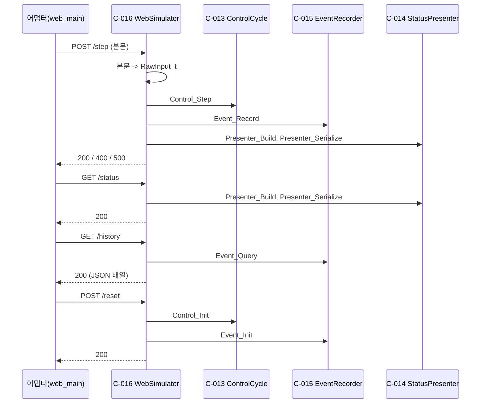

# ARCH-iter2 — 표시·이력·Web 아키텍처 설계서 (Iter-2)

| 항목 | 내용 |
|------|------|
| 문서 ID | DOC-ARC-002 |
| 버전 | 0.4 (3차 설계 리뷰 반려 조치본) |
| 상태 | 초안 (재리뷰 대기) |
| 작성 | Claude Sonnet 5.5, 2026-11-27, 요청자 KYLee |
| 입력 | DOC-ARC-001 v0.2 (ARCH-C-014~016 정의, 이 문서가 구체화), DOC-SRS-001 v1.0 |

DOC-ARC-001의 ARCH-C-014(StatusPresenter), ARCH-C-015(EventRecorder), ARCH-C-016(WebSimulator)과 ARCH-I-008~010은 이 문서의 정의로 **대체**한다 (DOC-ARC-001의 해당 행과 정적 구조 그림은 이 결정에 맞춰 개정했다). **ControlCycle은 표시·이력을 모르고**, WebSimulator가 ControlCycle, EventRecorder, StatusPresenter를 조합한다. 이유: 제어 코어가 표시·저장 관심사와 결합하지 않게 한다 (S, D).

## 1. 설계 결정

- ARCH-D-06: Web은 **C로 만든 HTTP 어댑터**다. 요청 처리 로직(`Web_Handle`)은 소켓을 모르는 순수 함수이고, 소켓 루프(`web_main.c`)는 얇은 어댑터다. 이유: Clang 도구체인과 품질 게이트를 유지하고 요청 처리를 단위 테스트할 수 있다. 소켓 어댑터는 시연(SRS-C-004)으로 검증한다.
- ARCH-D-07: 표시용 직렬화는 JSON 텍스트이며 StatusPresenter가 만든다. 버퍼 용량이 모자라면 직렬화 실패로 보고 HTTP 500을 응답한다 (SRS-F-023).
- ARCH-D-08 (A-20): SRS 6.4 OEM-IF-006과 SRS 6.1 "결정"은 priority_reason, reason_code를 **단일 값**으로 정의한다. 제어 코어는 도어별 이유를 유지하되, `CycleResult_t`에 요약 값 `priority_reason_summary`, `reason_code_summary`를 추가해 제공한다 (규칙: 좌 도어 값이 NONE이 아니면 좌, 아니면 우). 표시와 이력은 요약 값만 쓴다. 이유: SRS 정의를 따르고 규칙을 한 곳(ControlCycle)에만 둔다. 이력의 결정 판정은 SRS-F-025대로 (좌/우 출력, state, reason_code_summary)이다.
- ARCH-D-09: 이벤트 ID는 64비트 정수로 하며 1부터 증가한다 (오버플로로 인한 중복 없음).
- ARCH-D-10 (A-21): SRS 6.2는 경고코드 값으로 W-001만 정의한다. 경고가 없을 때의 표시 문자열 `"NONE"`은 SRS가 정하지 않아 설계가 정한 표시값이다.
- ARCH-D-11: Web은 제어 주기와 이력을 호출하기 전에 컨텍스트를 초기화하고(Web_Init) 논리 시각을 주기 번호에서 만들어(단조 증가) 넘기므로, Control_Step과 Event_Record, Event_Query는 Web 경로에서 오류를 반환하지 않는다. 따라서 Web은 이 호출의 반환값으로 분기하지 않는다. HTTP 500은 **응답 본문 상한을 넘는 직렬화 실패**에서만 발생한다. 본문 상한은 `Web_t`의 값(기본 `WEB_BODY_CAPACITY`)이며 시험이 줄일 수 있다.
- ARCH-D-12: 평가된 주기가 아직 없을 때(첫 `POST /step` 이전) `GET /status`는 HTTP 204(내용 없음, 빈 본문)로 응답한다. 값을 만들어 내지 않으므로 SSR-015(state 결정)와 충돌하지 않는다.
- ARCH-D-13: 응답 본문 상한은 `Web_SetBodyLimit`으로만 바꾸며 1 이상 `WEB_BODY_CAPACITY` 이하여야 한다 (버퍼 넘침 방지). `Web_Init`은 상한을 `WEB_BODY_CAPACITY`로 설정한다.

## 2. 정적 구조

의존은 위에서 아래로만 향하고 순환이 없다. C-014, C-015, C-013은 서로를 호출하지 않는다.

## 3. 컴포넌트 정의

| ID | 이름 | 책임 (한 문장) | 제공 IF | 요구 IF | 담당 요구 | Iter |
|----|------|----------------|---------|---------|-----------|------|
| ARCH-C-014 | StatusPresenter | 한 주기의 최종 결과를 표시 항목으로 만들고 JSON으로 직렬화한다. | ARCH-I-008 | — (CycleResult_t는 호출자가 넘기는 데이터이며 ARCH-I-007을 호출하지 않는다) | SRS-F-018, SRS-F-019, SRS-F-022, SRS-F-023, SRS-Q-003 | 2 |
| ARCH-C-015 | EventRecorder | 결정이 바뀐 주기를 고유 ID 이벤트로 기록하고 최근 100건만 메모리에 보존한다. | ARCH-I-009 | — | SRS-F-020, SRS-F-021, SRS-F-024, SRS-F-025, SRS-F-026, SRS-L-006, SRS-Q-002 | 2 |
| ARCH-C-016 | WebSimulator | 시험 입력을 받아 제어 주기를 실행하고 상태와 이력을 HTTP로 보여 준다. (모듈: 요청 처리 web_handler, 화면 web_page, 입력 해석 web_request_parser, 어댑터 web_main) | ARCH-I-010 | ARCH-I-007, ARCH-I-008, ARCH-I-009 | SRS-C-004 | 2 |

## 4. 인터페이스 정의

| ID | 이름 | 제공자 → 사용자 | 동작 | 사전·사후 조건 | 오류 처리 | 타이밍·자원 |
|----|------|-----------------|------|----------------|-----------|-------------|
| ARCH-I-008 | 상태 표시 | C-014 → C-016 | `Status_t Presenter_Build(const CycleResult_t *res /*in*/, PresentedStatus_t *out /*out*/)`; `Status_t Presenter_Serialize(const PresentedStatus_t *st /*in*/, char *buf /*out*/, size_t cap /*in, 1 이상*/, int *http_status /*out: 200 또는 500*/)` | Build 사후: 좌/우 출력, state, 요약 priority_reason, 요약 reason_code, 경고코드("NONE"/"W-001", ARCH-D-10), input_validity 13항목이 SRS 6.2 열거형 이름으로 채워진다. Serialize 사후: 성공이면 buf에 JSON과 http_status=200, 용량 부족이면 buf를 빈 문자열로 하고 http_status=500 | 널이면 STATUS_ERR_PARAM(http_status가 널이 아니면 500). 용량 부족은 오류 코드가 아니라 http_status=500 | 동기, 상태 비보유, 스레드 안전 |
| ARCH-I-009 | 이벤트 기록 | C-015 → C-016 | `Status_t Event_Init(Event_t *ctx /*out*/)`; `Status_t Event_Record(Event_t *ctx /*inout*/, const CycleResult_t *res /*in*/, double timestamp_s /*in*/)`; `Status_t Event_Query(const Event_t *ctx /*in*/, EventEntry_t *out /*out*/, size_t cap /*in*/, size_t *count /*out*/)` | Record 사후: 직전 기록 기준과 (좌/우 출력, state, reason_code_summary) 중 하나라도 다르면 이벤트 1건 추가(ID는 1부터 64비트로 증가, 중복 없음), 최대 100건 보존(가장 오래된 것부터 덮어씀). Query 사후: 보존된 이벤트를 오래된 순서로 out에 복사하고 count 설정 | 널이면 STATUS_ERR_PARAM, 미초기화면 STATUS_ERR_STATE, Query에서 cap이 보존 건수보다 작으면 STATUS_ERR_PARAM | 동기, 컨텍스트 소유자 단일 스레드, 메모리만 사용 |
| ARCH-I-010 | Web 요청 처리 | C-016 → 어댑터 | `Status_t Web_Init(Web_t *ctx /*out*/)`; `Status_t Web_SetBodyLimit(Web_t *ctx /*inout*/, size_t limit /*in, 1 이상 WEB_BODY_CAPACITY 이하*/)`; `Status_t Web_Handle(Web_t *ctx /*inout*/, const WebRequest_t *req /*in*/, WebResponse_t *resp /*out*/)`. WebRequest_t = method, path, body(널이 아닌 문자열, 본문이 없으면 빈 문자열). WebResponse_t = status(int), content_type(문자열), body(고정 크기 버퍼 `WEB_BODY_CAPACITY`) | 경로·메서드 표: `GET /` HTML 화면, `GET /status` 마지막 상태 JSON, `GET /history` 이벤트 JSON 배열, `POST /step` 본문의 `이름=값&...`으로 입력을 구성해 한 주기를 실행하고 상태 JSON, `POST /reset` 초기화. 성공은 200(평가된 주기가 없을 때의 `GET /status`는 204), 알 수 없는 경로 404, 경로는 있으나 메서드가 다르면 405, 본문 구문·이름 오류 400, 응답 본문 상한을 넘는 경우 500(`GET /`의 화면, `GET /status`와 `POST /step`의 직렬화, `GET /history`의 이력 쓰기) | 인자 널이면 STATUS_ERR_PARAM(SetBodyLimit은 limit이 범위 밖이어도 ERR_PARAM). HTTP 오류는 resp->status로 표현하고 반환값은 STATUS_OK | 동기, 요청 1건씩 직렬 처리 |

## 5. 동적 구조

## 6. 요구 → 컴포넌트 배정

| 요구 ID | 컴포넌트 |
|---------|----------|
| SRS-F-018 | ARCH-C-014 |
| SRS-F-019 | ARCH-C-014 |
| SRS-F-020 | ARCH-C-015 |
| SRS-F-021 | ARCH-C-015 |
| SRS-F-022 | ARCH-C-014 |
| SRS-F-023 | ARCH-C-014 |
| SRS-F-024 | ARCH-C-015 |
| SRS-F-025 | ARCH-C-015 |
| SRS-F-026 | ARCH-C-015 |
| SRS-Q-002 | ARCH-C-014, ARCH-C-015 |
| SRS-Q-003 | ARCH-C-014 |
| SRS-L-006 | ARCH-C-015 |
| SRS-C-004 | ARCH-C-016 |

SRS-F-011, 012, 013은 SRS 1.0에서 폐기된 ID이며 이 문서와 DOC-ARC-001에서 배정하지 않는다.

## 7. 점검표 결과

| 항목 | 결과 |
|------|------|
| 응집도·결합도 | 세 컴포넌트가 서로 호출하지 않고 WebSimulator만 조합한다. 순환 의존 없음. ControlCycle은 표시·이력과 결합하지 않는다 |
| 캡슐화 | Event_t, Web_t 내부는 소유 컴포넌트 소스에서만 접근한다 |
| SOLID | S: 표시, 저장, 조합 분리. D: WebSimulator는 각 컴포넌트의 공개 헤더에 의존한다 |
| 비기능 | Q-002: 이벤트와 표시 스키마에 영상, 음성, 식별자 필드 없음. Q-003: 입출력 이름과 값 집합이 SRS 6.4 정의와 같다. L-006: params.h의 HISTORY_CAPACITY |
