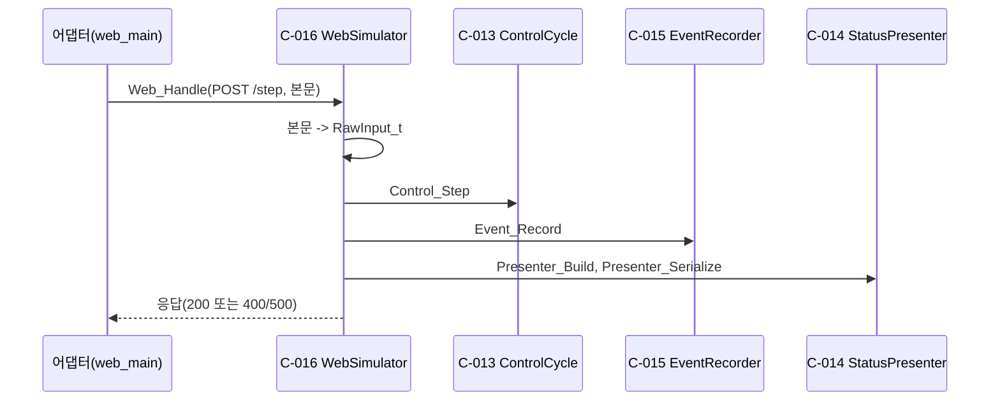

# ARCH-iter2 — 표시·이력·Web 아키텍처 설계서 (Iter-2)

| 항목 | 내용 |
|------|------|
| 문서 ID | DOC-ARC-002 |
| 버전 | 0.1 |
| 상태 | 초안 (리뷰 대기) |
| 작성 | Claude Sonnet 5.5, 2026-11-27, 요청자 KYLee |
| 입력 | DOC-ARC-001 v0.1 (ARCH-C-014~016 정의와 ARCH-I-008~010 초안), DOC-SRS-001 v1.0 |

DOC-ARC-001의 ARCH-C-014(StatusPresenter), ARCH-C-015(EventRecorder), ARCH-C-016(WebSimulator)을 구체화한다. 이 문서의 정의가 DOC-ARC-001의 같은 ID 정의보다 우선하며, DOC-ARC-001 5장의 "ControlCycle이 EventRecorder, StatusPresenter를 호출한다"는 구조는 다음처럼 바꾼다: **ControlCycle은 Iter-1과 같이 표시·이력을 모르고**, WebSimulator가 ControlCycle, EventRecorder, StatusPresenter를 조합한다. 이유: 제어 코어가 표시·저장 관심사와 결합하지 않게 한다(S, D).

## 1. 설계 결정

- ARCH-D-06: Web 구현 방식은 **C로 만든 HTTP 어댑터**로 한다 (사용자가 추천안으로 진행하라고 함). 요청 처리 로직(`Web_Handle`)은 소켓을 모르는 순수 함수이고, 소켓 루프(`web_main.c`)는 얇은 어댑터다. 이유: Clang 도구체인과 품질 게이트를 유지하고, 요청 처리 로직을 단위 테스트할 수 있다. 소켓 어댑터는 시연(SRS-C-004)으로 검증한다.
- ARCH-D-07: 표시용 직렬화는 JSON 텍스트이며 StatusPresenter가 만든다. 버퍼 용량이 모자라면 직렬화 실패로 보고 HTTP 500을 응답한다 (SRS-F-023).
- ARCH-D-08: 이벤트의 reason_code 필드는 좌측 도어의 reason_code가 NONE이 아니면 그 값, 아니면 우측 도어의 값이다. 결정 여부(변화 감지)는 도어별 출력, state, 도어별 reason_code 전체로 판단한다 (A-09, A-15).

## 2. 컴포넌트 정의 (구체화)

| ID | 이름 | 책임 (한 문장) | 제공 IF | 요구 IF | 담당 요구 | Iter |
|----|------|----------------|---------|---------|-----------|------|
| ARCH-C-014 | StatusPresenter | 한 주기의 최종 결과를 표시 항목으로 만들고 JSON으로 직렬화한다. | ARCH-I-008 | — | SRS-F-011, SRS-F-012, SRS-F-013, SRS-F-018, SRS-F-019, SRS-F-022, SRS-F-023, SRS-Q-003 | 2 |
| ARCH-C-015 | EventRecorder | 결정이 바뀐 주기를 고유 ID 이벤트로 기록하고 최근 100건만 메모리에 보존한다. | ARCH-I-009 | — | SRS-F-020, SRS-F-021, SRS-F-024, SRS-F-025, SRS-F-026, SRS-L-006, SRS-Q-002 | 2 |
| ARCH-C-016 | WebSimulator | 시험 입력을 받아 제어 주기를 실행하고 상태와 이력을 HTTP로 보여 준다. | ARCH-I-010 | ARCH-I-007, ARCH-I-008, ARCH-I-009 | SRS-C-004 | 2 |

## 3. 인터페이스 정의

| ID | 이름 | 제공자 → 사용자 | 동작 | 사전·사후 조건 | 오류 처리 | 타이밍·자원 |
|----|------|-----------------|------|----------------|-----------|-------------|
| ARCH-I-008 | 상태 표시 | C-014 → C-016 | `Status_t Presenter_Build(const CycleResult_t *res /*in*/, PresentedStatus_t *out /*out*/)`; `Status_t Presenter_Serialize(const PresentedStatus_t *st /*in*/, char *buf /*out*/, size_t cap /*in, 1 이상*/, int *http_status /*out: 200 또는 500*/)` | 사전: 인자가 널이 아님. 사후(Build): 좌/우 출력, state, 도어별 priority_reason과 reason_code, warning_code, input_validity 13항목이 6.2 열거형 이름으로 채워짐. 사후(Serialize): 성공 시 buf에 JSON 문자열과 http_status=200, 용량 부족 시 buf를 빈 문자열로 만들고 http_status=500 | 널이면 STATUS_ERR_PARAM(http_status가 널이 아니면 500). 용량 부족은 오류 코드가 아니라 http_status=500으로 표현 | 동기, 상태 비보유, 스레드 안전 |
| ARCH-I-009 | 이벤트 기록 | C-015 → C-016 | `Status_t Event_Init(Event_t *ctx /*out*/)`; `Status_t Event_Record(Event_t *ctx /*inout*/, const CycleResult_t *res /*in*/, double timestamp_s /*in*/)`; `Status_t Event_Query(const Event_t *ctx /*in*/, EventEntry_t *out /*out*/, size_t cap /*in*/, size_t *count /*out*/)` | 사전: Init 후 사용. 사후(Record): 직전 기록 기준과 출력, state, 도어별 reason_code 중 하나라도 다르면 이벤트 1건 추가(ID는 1부터 증가하며 중복 없음), 최대 100건 보존(가장 오래된 것부터 덮어씀). 사후(Query): 보존된 이벤트를 오래된 순서로 out에 복사하고 count에 건수 | 널이면 STATUS_ERR_PARAM, 미초기화면 STATUS_ERR_STATE, Query에서 cap이 보존 건수보다 작으면 STATUS_ERR_PARAM | 동기, 컨텍스트 소유자 단일 스레드, 메모리만 사용 |
| ARCH-I-010 | Web 요청 처리 | C-016 → 어댑터(web_main) | `Status_t Web_Init(Web_t *ctx /*out*/)`; `Status_t Web_Handle(Web_t *ctx /*inout*/, const WebRequest_t *req /*in*/, WebResponse_t *resp /*out*/)`. WebRequest_t = method, path, body(문자열). WebResponse_t = status(int), content_type(문자열), body(고정 크기 버퍼) | 경로: `GET /` HTML 화면 200, `GET /status` 마지막 상태 JSON 200, `GET /history` 이벤트 JSON 200, `POST /step` 본문의 `이름=값&...`으로 입력을 구성해 한 주기를 실행하고 상태 JSON 200, `POST /reset` 초기화 200, 알 수 없는 경로 404, 지원하지 않는 메서드 405, 본문 구문·이름 오류 400, 제어 주기 오류 또는 직렬화 실패 500 | 널이면 STATUS_ERR_PARAM. HTTP 오류는 resp->status로 표현하고 반환값은 STATUS_OK | 동기, 요청 1건씩 직렬 처리 |

## 4. 동적 구조 (POST /step)

## 5. 요구 → 컴포넌트 배정

| 요구 ID | 컴포넌트 |
|---------|----------|
| SRS-F-011 | ARCH-C-014 |
| SRS-F-012 | ARCH-C-014 |
| SRS-F-013 | ARCH-C-014 |
| SRS-F-018 | ARCH-C-014 |
| SRS-F-019 | ARCH-C-014 |
| SRS-F-020 | ARCH-C-015 |
| SRS-F-021 | ARCH-C-015 |
| SRS-F-022 | ARCH-C-014 |
| SRS-F-023 | ARCH-C-014 |
| SRS-F-024 | ARCH-C-015 |
| SRS-F-025 | ARCH-C-015 |
| SRS-F-026 | ARCH-C-015 |
| SRS-Q-002 | ARCH-C-014, ARCH-C-015 |
| SRS-Q-003 | ARCH-C-014 |
| SRS-L-006 | ARCH-C-015 |
| SRS-C-004 | ARCH-C-016 |

## 6. 점검표 결과

| 항목 | 결과 |
|------|------|
| 응집도·결합도 | 세 컴포넌트가 서로 호출하지 않고 WebSimulator만 조합한다. 순환 의존 없음, ControlCycle은 표시·이력과 결합하지 않는다 |
| 캡슐화 | Event_t, Web_t 내부는 소유 컴포넌트 소스에서만 접근한다 |
| SOLID | S: 표시, 저장, 조합 분리. D: WebSimulator는 각 컴포넌트의 공개 헤더에 의존한다 |
| 비기능 | Q-002: 이벤트와 표시 스키마에 영상, 음성, 식별자 필드 없음. Q-003: 입출력 이름과 값 집합이 SRS 6.4 정의와 같다. L-006: params.h의 HISTORY_CAPACITY |
