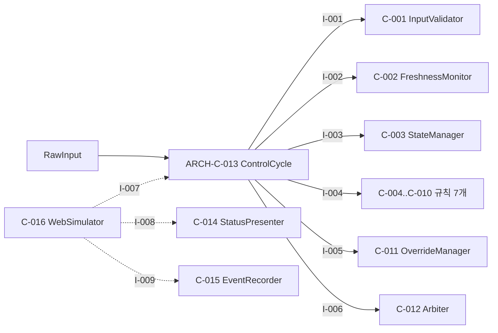
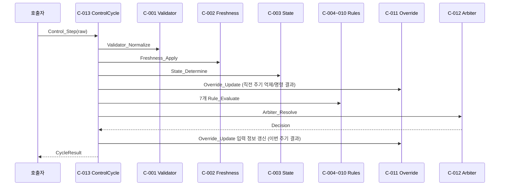

# ARCH — 전자식 차일드락 제어 SW 아키텍처 설계서

| 항목 | 내용 |
|------|------|
| 문서 ID | DOC-ARC-001 |
| 버전 | 0.2 (Iter-1, Iter-2 설계 리뷰 반영 개정) |
| 상태 | 리뷰 생략 (사용자 지시 2026-11-27 "이번 이터레이션은 리뷰는 넘어가자"), aspice-reviewer 미검토 |
| 작성 | Claude Sonnet 5.5, 2026-11-27, 요청자 KYLee |
| 입력 | DOC-SRS-001 v1.0, DOC-SAF-001 v1.0, DOC-ASM-001 v1.0 (모두 리뷰 승인) |

## 1. 설계 개요와 이터레이션 범위

- 언어와 스타일: C17, 함수는 상태 코드(`Status_t`)를 반환하고 `void`를 쓰지 않으며 `return`은 함수 끝에 한 번만 둔다. 전역 가변 데이터를 쓰지 않고 상태는 호출자가 소유한 컨텍스트 구조체로 전달한다 (SRS-C-001).
- 구조 원칙: 입력 검증 → 신선도 → 상태 결정 → 규칙 7개 평가 → 중재 → 출력의 **순수 함수 파이프라인**이다. 규칙은 서로를 모르며, 공통 인터페이스(ARCH-I-004)를 구현한다 (O, L, D).
- **이터레이션 범위(계획 조정)**: 우선순위 중재가 모든 규칙에 걸쳐 있어 분리할 수 없으므로 Iter-1은 **제어 코어 전체**(ARCH-C-001~013)를 구현하고, Iter-2는 표시·이력·Web(ARCH-C-014~016)을 구현한다. 처음 계획(운전자 기능을 Iter-2)에서 조정한 것이며 사용자 확인이 필요하다.
- 설계 결정:
  - ARCH-D-01: 규칙을 순위별 컴포넌트 7개로 나눈다. 이유: 규칙 하나가 변경될 이유가 하나이고(S), 규칙별로 단위 MC/DC 100%를 독립적으로 달성할 수 있다.
  - ARCH-D-02: DEGRADED/FAULT/OFF에 따른 규칙 억제(SSR-010, SSR-011, SRS-F-031)는 규칙이 아니라 Arbiter가 담당한다. 이유: 억제 정책이 한 곳에 있어 규칙 컴포넌트가 상태를 몰라도 된다.
  - ARCH-D-03: 시간 판정(10 ms 주기, 200 ms 신선도, 1,000주기 override)은 모두 입력 논리 시각(`timestamp_s`)과 주기 수로 계산하고 시스템 시계를 읽지 않는다. 이유: 결정론(SRS-Q-001)과 시계 주입(SRS-C-005).
  - ARCH-D-04: 3.0 km/h, 1,000주기, 200 ms, 100건 같은 수치는 읽기 전용 컴파일 시간 상수 헤더(`params.h`)에 두고 각 컴포넌트가 읽는다. 가변 공유 데이터가 아니므로 결합 위반이 아니다.
  - ARCH-D-05: OEM의 override 상태(SRS-F-007) 추적은 ApproachRiskRule에 넣지 않고 OverrideManager로 분리한다. 이유: 접근위험 판정(순수 함수)과 시간 경과 상태(상태 보유)를 섞지 않는다.

## 2. 정적 구조

- 의존 방향: ControlCycle이 모든 하위 컴포넌트를 호출한다. 표시·이력(C-014, C-015)은 ControlCycle이 아니라 WebSimulator(C-016)가 호출한다 (DOC-ARC-002). 하위 컴포넌트끼리는 서로 호출하지 않는다(규칙은 규칙을 호출하지 않고, Arbiter는 규칙을 호출하지 않으며 결과 배열만 받는다). 순환 의존이 없다.
- 공용 타입은 `common/types.h`(데이터 정의만, 함수 없음)에 두고 인터페이스 시그니처에 노출한다.

## 3. 컴포넌트 정의

| ID | 이름 | 책임 (한 문장) | 제공 IF | 요구 IF | 담당 요구 | 비기능 고려 | Iter |
|----|------|----------------|---------|---------|-----------|-------------|------|
| ARCH-C-001 | InputValidator | 원시 입력의 누락, 형식, 범위, 값 집합을 검증해 정규화된 VehicleSnapshot을 만든다. | ARCH-I-001 | — | SRS-F-001, SRS-Q-003, SRS-L-007, SRS-C-003, SSR-007 | SRS-L-007 범위 상수, SRS-C-001 C17 | 1 |
| ARCH-C-002 | FreshnessMonitor | 필수 입력의 마지막 갱신 시각을 보관하고 200 ms 초과 입력을 stale로 표시한다. | ARCH-I-002 | — | SSR-008, SSR-009 | 논리 시각만 사용(ARCH-D-03) | 1 |
| ARCH-C-003 | StateManager | 스냅샷으로 state(OFF/FAULT/DEGRADED/NORMAL)와 경고코드를 결정한다. | ARCH-I-003 | — | SSR-009, SSR-012, SSR-014, SSR-015, SRS-F-016, SRS-F-027 | 상태 비보유(순수 함수) | 1 |
| ARCH-C-004 | CrashRule | crash_status가 CONFIRMED이면 좌, 우 RELEASE를 요구하고 PENDING이면 이유 코드만 요구한다. | ARCH-I-004 | — | SSR-001, SSR-002, SSR-003 | SSR-002 같은 주기 처리 | 1 |
| ARCH-C-005 | EmergencyReleaseRule | 화재, 과온, 성인 탑승 입력이 TRUE이면 좌, 우 RELEASE를 요구한다. | ARCH-I-004 | — | SRS-F-014 | — | 1 |
| ARCH-C-006 | IgnitionRule | ignition_on이 FALSE이면 좌, 우 RELEASE를 요구한다. | ARCH-I-004 | — | SRS-F-016 | — | 1 |
| ARCH-C-007 | ApproachRiskRule | 접근위험이 TRUE인 도어에 LOCK을 요구하고 해제 요청 억제 여부를 알린다. | ARCH-I-004 | — | SSR-004, SSR-005, SSR-006 | 좌우 독립 | 1 |
| ARCH-C-008 | IsofixRule | ISOFIX가 TRUE인 쪽에 LOCK을 요구한다. | ARCH-I-004 | — | SRS-F-015 | — | 1 |
| ARCH-C-009 | DriverCommandRule | 운전자 명령을 속도 조건에 따라 허용 여부를 정해 선택 도어의 출력으로 요구한다. | ARCH-I-004 | — | SRS-F-001, SRS-F-002, SRS-F-003, SRS-F-007, SRS-F-029 | SRS-L-004 상수 | 1 |
| ARCH-C-010 | AutoLockRule | 유효 차속이 3.0 km/h 이상이면 좌, 우 LOCK을 요구한다. | ARCH-I-004 | — | SRS-F-004 | SRS-L-004 상수 | 1 |
| ARCH-C-011 | OverrideManager | 접근위험 해제 억제 시점과 재입력을 추적해 도어별 override 지속 상태를 결정한다. | ARCH-I-005 | — | SRS-F-007, SRS-F-029, SRS-F-030 | SRS-L-005 주기 수 | 1 |
| ARCH-C-012 | Arbiter | 규칙 결과를 우선순위로 합쳐 도어별 출력과 priority_reason을 결정하고 상태에 따른 억제를 적용한다. | ARCH-I-006 | — | SRS-F-017, SRS-F-028, SRS-F-031, SSR-010, SSR-011, SSR-013, SSR-016 | 결정론(SRS-Q-001) | 1 |
| ARCH-C-013 | ControlCycle | 한 평가주기 동안 하위 컴포넌트를 정해진 순서로 호출하고 직전 출력과 컨텍스트를 관리한다. | ARCH-I-007 | I-001~I-006 | SRS-Q-001, SRS-C-001, SRS-C-002, SRS-C-005, SSR-002 | 상태는 컨텍스트에만 보관 | 1 |
| ARCH-C-014 | StatusPresenter | (DOC-ARC-002 ARCH-iter2 3장이 이 컴포넌트를 정의한다. 아래 내용은 초안이며 대체됨) | — | — | — | — | 2 |
| ARCH-C-015 | EventRecorder | (DOC-ARC-002 ARCH-iter2 3장이 이 컴포넌트를 정의한다. 아래 내용은 초안이며 대체됨) | — | — | — | — | 2 |
| ARCH-C-016 | WebSimulator | (DOC-ARC-002 ARCH-iter2 3장이 이 컴포넌트를 정의한다. 아래 내용은 초안이며 대체됨) | — | — | — | — | 2 |

## 4. 인터페이스 정의

공용 타입(`common/types.h`):

| 타입 | 정의 |
|------|------|
| Status_t | STATUS_OK=0 정상, STATUS_ERR_PARAM=1 인자 오류(널 포인터 등), STATUS_ERR_STATE=2 컨텍스트 오류 |
| Output_t | OUTPUT_RELEASE, OUTPUT_LOCK |
| Door_t | DOOR_LEFT=0, DOOR_RIGHT=1 (배열 인덱스) |
| Validity_t | VALIDITY_VALID, VALIDITY_INVALID |
| RawValue_t | kind(ABSENT, NUMBER, BOOLEAN, ENUM_ID, OTHER), number(double), boolean(int), enum_id(int). OTHER는 형식 오류를 나타낸다 |
| RawInput_t | timestamp_s(double, VehicleSnapshot 시각), 입력 필드별 RawValue_t (speed, gear, source_timestamp, crash_status, approach_risk[2], fire, overtemp, adult, isofix[2], ignition_on, sensor_fault), 명령 필드(side, action, source, present) |
| Snapshot_t | timestamp_s, 필드별 값과 Validity_t, stale 표시, 명령(valid, side, action, source) |
| State_t | STATE_OFF, STATE_NORMAL, STATE_DEGRADED, STATE_FAULT |
| ReasonCode_t | SRS 6.2의 reason_code 17개 값 |
| RuleResult_t | 도어별 active(0/1), 도어별 effect(Output_t), reason_code, suppressed_unlock[2](ApproachRiskRule만), command_applied[2](DriverCommandRule만) |
| Decision_t | 도어별 output, priority_reason(ReasonCode_t), reason_code |
| CycleResult_t | output[2], state, priority_reason[2], reason_code[2](도어별), priority_reason_summary, reason_code_summary(SRS 6.4 단일 값: 좌가 NONE이 아니면 좌, 아니면 우), warning_code(0 또는 1=W-001), input_validity(비트 마스크) |

| ID | 이름 | 제공자 → 사용자 | 동작 (시그니처) | 사전·사후 조건 | 오류 처리 | 타이밍·자원 |
|----|------|-----------------|-----------------|----------------|-----------|-------------|
| ARCH-I-001 | 입력 검증 | C-001 → C-013 | `Status_t Validator_Normalize(const RawInput_t *raw /*in*/, Snapshot_t *snap /*out*/)` | 사전: raw, snap이 널이 아니다. 사후: 모든 필드가 VALID/INVALID로 표시된 Snapshot, INVALID 값은 규칙 조건에 쓰이지 않도록 표시, gear INVALID는 필수 입력 판정에 영향 없음 | 널이면 STATUS_ERR_PARAM(snap 미수정). 입력 값 오류는 오류 코드가 아니라 INVALID로 표현 | 동기, 상태 비보유, 스레드 안전 |
| ARCH-I-002 | 신선도 적용 | C-002 → C-013 | `Status_t Freshness_Apply(Freshness_t *ctx /*inout*/, Snapshot_t *snap /*inout*/)` | 사전: ctx 초기화됨, snap은 I-001 출력. 사후: 필수 입력 중 시각 차이가 200 ms 초과(IF-001은 timestamp_s − source_timestamp_s, 그 외는 수신 논리 시각 기준)인 것은 stale 표시와 INVALID, 갱신된 시각을 ctx에 기록 | 널이면 STATUS_ERR_PARAM, ctx 미초기화면 STATUS_ERR_STATE | 동기, 컨텍스트 소유자 단일 스레드 |
| ARCH-I-003 | 상태 결정 | C-003 → C-013 | `Status_t State_Determine(const Snapshot_t *snap /*in*/, State_t *state /*out*/, int *warning_code /*out: 0 또는 1(W-001)*/)` | 사후: SSR-015에 따라 OFF > FAULT > DEGRADED > NORMAL, sensor_fault가 유효한 TRUE이면 warning_code=1 | 널이면 STATUS_ERR_PARAM | 동기, 상태 비보유 |
| ARCH-I-004 | 규칙 평가 (공통) | C-004~C-010 → C-013 | `Status_t <Rule>_Evaluate(const RuleInput_t *in /*in*/, RuleResult_t *out /*out*/)` (`<Rule>`: Crash, Emergency, Ignition, ApproachRisk, Isofix, DriverCommand, AutoLock). RuleInput_t = Snapshot_t, State_t, 직전 출력[2], OverrideStatus_t | 사전: in, out이 널이 아니다. 사후: 조건이 성립하지 않으면 active=0, 성립하면 도어별 effect와 reason_code 설정. 같은 입력은 항상 같은 결과(순수 함수) | 널이면 STATUS_ERR_PARAM(out 미수정) | 동기, 상태 비보유, 모든 규칙이 같은 시그니처(대체 가능) |
| ARCH-I-005 | override 추적 | C-011 → C-013 | `Status_t Override_Update(Override_t *ctx /*inout*/, const OverrideInput_t *in /*in*/, OverrideStatus_t *out /*out*/)`. OverrideInput_t = 주기 번호(uint32_t), 도어별 suppressed_unlock, 도어별 접근위험 유효 TRUE 여부, 유효 차속 3.0 km/h 이상 여부, 도어별 unlock/lock 명령 적용 여부, 도어별 명령 허용 여부 | 사후: 억제 후 1,000주기 이하 재입력이면 해당 도어 override 성립, 종료 조건(접근위험 FALSE, 3.0 km/h 이상, 적용되는 lock 명령)이 성립하면 해제, OverrideStatus_t = 도어별 active | 널이면 STATUS_ERR_PARAM, 주기 번호 역행이면 STATUS_ERR_STATE | 동기, 컨텍스트 상태 보유, 주기당 1회 호출 |
| ARCH-I-006 | 중재 | C-012 → C-013 | `Status_t Arbiter_Resolve(const ArbiterInput_t *in /*in*/, Decision_t *out /*out*/)`. ArbiterInput_t = RuleResult_t[7](순위 1~7 순서), State_t, 직전 출력[2], OverrideStatus_t | 사후: 도어별로 활성 규칙 중 가장 높은 순위의 효과, 없으면 직전 출력과 NONE. OFF이면 순위 4~7, DEGRADED/FAULT이면 순위 6을 활성에서 제외하고 억제된 명령의 reason_code를 설정. override 지속은 순위 6 효과(reason OVERRIDE)로 반영 | 널이면 STATUS_ERR_PARAM | 동기, 상태 비보유 |
| ARCH-I-007 | 제어 주기 실행 | C-013 → C-014, C-016, 테스트 | `Status_t Control_Init(Control_t *ctx /*out*/)`, `Status_t Control_Step(Control_t *ctx /*inout*/, const RawInput_t *raw /*in*/, CycleResult_t *out /*out*/)` | 사전: Init 후 호출, raw->timestamp_s는 단조 증가(10 ms 단위). 사후: out은 6.3 규칙과 SSR/SRS 요구를 만족하는 결과, 직전 출력 갱신 | 널이면 STATUS_ERR_PARAM, 미초기화 STATUS_ERR_STATE. 하위 컴포넌트 오류는 그대로 전파하고 직전 출력은 변경하지 않음 | 동기, 주기당 1회(10 ms), 스레드 비안전(호출자가 직렬화) |
| ARCH-I-008 | 상태 표시 | (DOC-ARC-002 4장이 정의한다) | — | — | — | — |
| ARCH-I-009 | 이벤트 기록 | (DOC-ARC-002 4장이 정의한다) | — | — | — | — |
| ARCH-I-010 | Web 입출력 | (DOC-ARC-002 4장이 정의한다) | — | — | — | — |

## 5. 동적 구조 (한 평가주기)

- ControlCycle은 주기 끝에 이번 주기의 억제·명령 적용 결과를 OverrideManager 입력으로 보관하고, 다음 주기 시작에 `Override_Update`로 전달한다. 따라서 규칙과 OverrideManager 사이에 순환 호출이 없다.

## 6. 비기능 요구 반영

| 요구 | 반영 |
|------|------|
| SRS-Q-001 결정론 | 규칙과 중재는 순수 함수, 상태는 컨텍스트에만 있고 시스템 시계, 난수, 전역을 쓰지 않는다 (ARCH-D-03) |
| SRS-Q-002 개인정보 | 입력 스키마와 이벤트 스키마에 영상, 음성, 식별자 필드가 없다 (C-001 입력 타입, C-015 필드 한정) |
| SRS-Q-003 호환성 | IF 9건의 이름, 형식, 값 집합을 RawInput_t, CycleResult_t에 그대로 반영 |
| SRS-L-004~007 | `params.h`의 상수 (3.0, 1,000주기, 100건, 0.0~300.0) |
| SRS-C-001 | C17, Clang |
| SRS-C-002 | CycleResult_t에 출력만 있고 feedback 입력이 없다 |
| SRS-C-005 | 평가주기 10 ms, 시계는 입력으로 주입 |

## 7. 점검표 결과

| 항목 | 결과 |
|------|------|
| 응집도 | 컴포넌트마다 책임이 한 문장이며 "utils" 컴포넌트가 없다. ControlCycle은 순서 제어만 한다 |
| 결합도 | 순환 의존 없음. 하위 컴포넌트는 서로 호출하지 않고 ControlCycle만 의존한다. 공유 가변 데이터 없음(상수 헤더만) |
| 캡슐화 | 컨텍스트 구조체(Freshness_t, Override_t, Control_t)는 불투명 사용, 내부 필드는 컴포넌트 소스에서만 접근 |
| S | 규칙 컴포넌트마다 변경 이유가 하나 |
| O | 새 규칙은 ARCH-I-004를 구현하는 컴포넌트와 Arbiter 순위 테이블 항목 추가로 확장 (ControlCycle과 Arbiter의 규칙 목록 수정은 필요하나 기존 규칙은 변경 없음) |
| L | 7개 규칙이 같은 시그니처를 구현해 서로 같은 방식으로 호출된다 |
| I | 인터페이스가 컴포넌트별로 작다 (규칙 인터페이스는 한 함수) |
| D | ControlCycle이 인터페이스(헤더의 함수 시그니처)에 의존한다 |
| 추적성 | 8장 표와 TRACE.md |

## 8. 요구 → 컴포넌트 배정

| 요구 ID | 컴포넌트 |
|---------|----------|
| SRS-F-001 | ARCH-C-001, ARCH-C-009 |
| SRS-F-002 | ARCH-C-009 |
| SRS-F-003 | ARCH-C-009 |
| SRS-F-004 | ARCH-C-010 |
| SRS-F-007 | ARCH-C-009, ARCH-C-011 |
| SRS-F-014 | ARCH-C-005 |
| SRS-F-015 | ARCH-C-008 |
| SRS-F-016 | ARCH-C-003, ARCH-C-006 |
| SRS-F-017 | ARCH-C-012 |
| SRS-F-018 | ARCH-C-014 |
| SRS-F-019 | ARCH-C-014 |
| SRS-F-020 | ARCH-C-015 |
| SRS-F-021 | ARCH-C-015 |
| SRS-F-022 | ARCH-C-014 |
| SRS-F-023 | ARCH-C-014 |
| SRS-F-024 | ARCH-C-015 |
| SRS-F-025 | ARCH-C-015 |
| SRS-F-026 | ARCH-C-015 |
| SRS-F-027 | ARCH-C-003 |
| SRS-F-028 | ARCH-C-012 |
| SRS-F-029 | ARCH-C-009, ARCH-C-011, ARCH-C-012 |
| SRS-F-030 | ARCH-C-011 |
| SRS-F-031 | ARCH-C-012 |
| SRS-Q-001 | ARCH-C-013 |
| SRS-Q-002 | ARCH-C-014, ARCH-C-015 |
| SRS-Q-003 | ARCH-C-001, ARCH-C-014 |
| SRS-L-004 | ARCH-C-009, ARCH-C-010 |
| SRS-L-005 | ARCH-C-011 |
| SRS-L-006 | ARCH-C-015 |
| SRS-L-007 | ARCH-C-001 |
| SRS-C-001 | ARCH-C-013 |
| SRS-C-002 | ARCH-C-013 |
| SRS-C-003 | ARCH-C-001 |
| SRS-C-004 | ARCH-C-016 |
| SRS-C-005 | ARCH-C-013 |
| SSR-001 | ARCH-C-004 |
| SSR-002 | ARCH-C-004, ARCH-C-013 |
| SSR-003 | ARCH-C-004 |
| SSR-004 | ARCH-C-007 |
| SSR-005 | ARCH-C-007, ARCH-C-011 |
| SSR-006 | ARCH-C-007 |
| SSR-007 | ARCH-C-001 |
| SSR-008 | ARCH-C-002 |
| SSR-009 | ARCH-C-002, ARCH-C-003 |
| SSR-010 | ARCH-C-012 |
| SSR-011 | ARCH-C-012 |
| SSR-012 | ARCH-C-003 |
| SSR-013 | ARCH-C-012 |
| SSR-014 | ARCH-C-003 |
| SSR-015 | ARCH-C-003 |
| SSR-016 | ARCH-C-012 |

## 9. 사용자 결정이 필요한 설계 선택지

| 번호 | 선택지 | 권장 |
|------|--------|------|
| 1 | 이터레이션 범위: Iter-1에 제어 코어 전체를 넣고 Iter-2를 표시·이력·Web으로 조정(권장) / 처음 계획대로 분리 | 조정안 (중재가 규칙 전체에 걸쳐 분리 불가) |
| 2 | Web 시뮬레이터(ARCH-C-016) 구현 방식: C 코어 위의 경량 HTTP 서버(CGI 또는 소형 서버 라이브러리) / Python 래퍼(사양서 Python 3.12와 맞음) | Iter-2 착수 전에 결정 |
